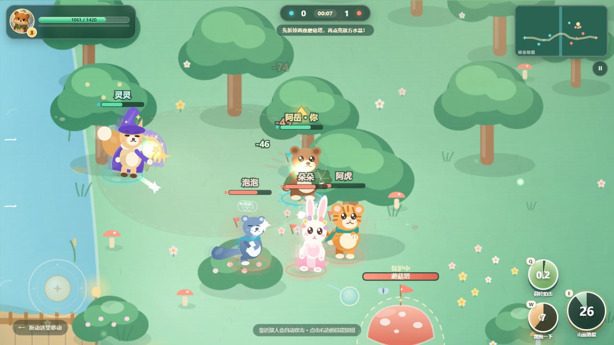

# 萌兽峡谷 TapArena

一个给 6–12 岁孩子玩的 **3v3 森林推塔小游戏**。玩法借鉴 MOBA 的“清兵线、拆塔、推水晶”，但节奏更短、规则更简单，所有角色都是原创萌兽，没有抽卡、内购、广告，也不联网。

- HTML 试玩版：`www/index.html`（横屏，建议 Chrome / Edge）
- 安卓版：`TapArena-v1.3.0.apk`（Android 7.0+，锁横屏，离线运行，无网络权限）





## 1.3.0 更新：战场改成真 3D

- **俯视 2D 换成 Three.js 立体战场**：透视相机、平行光 + 半球光、实时软阴影、雾与纵深，峡谷变成一座可以俯视的沙盘；62 棵树与灌木从「画在地面上」改成了真立体道具。
- **六位英雄重新做成骨架模型**（每人 11–13 个部件），关节枢轴放在肩/髋/颈/尾根，动作由 `anim.js` 的关键帧通道驱动。
- **动作补了「发力链」**：出招先反拧腰再甩出去、身体前冲、受击沿来击方向后撤、走路对侧摆臂、头部滞后跟随转体——这些是「看着顺不顺手」的关键。
- **遮挡淡出**：比主角更靠近镜头的树和塔会自动变半透明，解决 3D 特有的「前景挡住战场」。
- 名字、血条、伤害数字仍走 2D 投影叠加，任何 DPI 下都清晰；`?render=2d` 可强制回退到原 2D 画面，探测不到 WebGL 时也会自动回退。

已知不足：角色建模是首轮产物（尾巴偏粗、条纹是贴附外壳片），命中火花还没换成 3D 粒子，低端机帧率略低于 2D 版。详见 [CHANGELOG.md](CHANGELOG.md)。

## 怎么玩

1. 选一位小英雄：阿虎（战士）、灵灵（法师）、朵朵（辅助）、阿岳（坦克）、泡泡（控制）、尖尖（射手）；双方各 3 位、互不重复。
2. 跟随小果冻兵线往右走，先拆掉敌方两座蘑菇塔。
3. 两座塔都拆掉后，敌方水晶护盾消失，攻击水晶就能获胜。
4. 8 分钟进入“终极对决”：双方水晶护盾全部消失，水晶可以直接攻击，保证一局能结束。

目标是让第一次玩的小朋友也能看懂：**往右走 → 打塔 → 打水晶**。角色会自动攻击附近敌人，技能会自动瞄准。

### 操作

| 平台 | 移动 | 技能 |
| --- | --- | --- |
| 手机 / 平板 | 左下角拖动摇杆 | 右下角 Q / W / E 技能（E 大招 2 级解锁） |
| 电脑 | WASD / 方向键 | Q / W / E 技能 |
| 暂停 | 右上角暂停键或 P / Esc | 暂停面板里可开关音效、重开、回首页 |

## 安卓版

安装 `TapArena-v1.3.0.apk` 即可，首次启动不需要任何权限。应用包名 `com.sctale.taparena`，版本 1.3.0，最低 Android 7.0（API 24）。

- 横屏锁定；支持刘海屏；全屏沉浸式。
- 返回键：在战斗中按下会打开暂停面板，不会直接退出。
- 数据只保存在本机（音效偏好），不联网、不上传。

## 开发 / 构建

HTML 版是纯原生 Canvas + JavaScript，无构建步骤、无外部 CDN：

```text
www/
  index.html
  css/style.css
  js/data.js     英雄/技能/数值
  js/render.js   程序化地图与角色绘制
  js/anim.js     关键帧动画 clip 数据与采样（动作时长/缓动都在这儿）
  js/stage.js    Phaser 3 特效层（WebGL 粒子，失败自动回退）
  js/game.js     战斗逻辑、AI、UI、音效
  js/vendor/phaser.min.js  Phaser 3.90（离线打包，无 CDN 依赖）
  assets/        AI 生成的英雄立绘与首页背景
```

安卓壳是一个原生 WebView 工程，离线加载 `android/app/src/main/assets/www`。构建发布包（会同步最新 HTML、签名、验签、检查清单）：

```powershell
powershell -ExecutionPolicy Bypass -File .\build.ps1
```

产物：项目根目录 `TapArena-v1.3.0.apk`。

### 视觉 / 性能自检脚本

```powershell
node tools/visual.js    # 三位英雄 待机·攻击·施法·受击·大招·阵亡 定格截图 + 混战帧率
node tools/closeup.js   # 只截玩家周围的特写，检查肢体与弧光
node tools/perf.js      # CDP 把 CPU 降频 4× / 6×，量手机端帧率余量
node tools/sim3.js      # 纯逻辑 AI 对局模拟
```

这些脚本依赖 `window.__TA` 上的调试入口（`stage` 摆位、`still` 定格、`pose` 指定动作进度）。它们只服务于自动化检查，不是给玩家玩的功能，改动战斗表现时不要删。

> 签名文件：`keystore/taparena-release.keystore` + `keystore.properties`（均被 gitignore）。**务必自行备份**，丢失后无法覆盖升级。

## 已验证

- **数值**：12 局 AI 模拟（六位英雄轮流当玩家，轻松/挑战混合）全部正常结束，最快 123.7s；每一局胜方都是先拆 2 座塔才破水晶，新技能没有绕过保护规则。
- **全流程**：Playwright 桌面 1440×900、手机横屏 900×430、竖屏 390×844；选人页 6 张卡无溢出、"出发"始终可见；首页→选人→战斗→暂停→结算无页面错误。
- **动作**：六位英雄 × 待机/攻击/施法/受击 定格截图逐张目视检查（`node tools/newheroes.js`）。
- **帧率**：`node tools/perf.js`（CDP CPU 降频）3D 模式桌面 4× 53.8fps、手机 4× 58.6fps、6× 40.6fps；同机 2D 回退模式 6× 约 44fps。
- **模拟器实机**（Android 16，1080×1920 转横屏）：v1.2.0 → v1.3.0 覆盖安装成功，首页角标 v1.3；3D 战场正常渲染（树影、遮挡淡出、技能环、击杀播报、摇杆、小地图都在），阿岳骨架站姿与血条投影位置正确。
- **WebGL 可行性探针**（`www/spike3d.html`）：同一台模拟器的 WebView 里 90 个 7 部件角色 + PCFSoft 阴影跑到 57fps（DPR 2），证明 3D 选型可用；Phaser 那条 WebGL 路径的失败是它自己的渲染目标配置问题。
- **APK 签名**：`CN=TapArena, OU=Games, O=sctale, C=CN`；清单 `versionCode=4 versionName=1.3.0`；`TapArena-v1.3.0.apk` SHA-256：`AC9C0C59D2E929FC1E9A1FCD51B70A1C5C34716DCB23F3F989036E6E0AD978BA`。

### 自检脚本

```powershell
node tools/sim3.js        # AI 对局模拟（数值与结束条件）
node tools/mobile.js      # 手机横竖屏全流程
node tools/visual.js      # 三位老英雄动作定格 + 混战帧率
node tools/newheroes.js   # 六位英雄动作定格 + 选人页布局
node tools/closeup.js     # 玩家周围特写，检查肢体与弧光
node tools/perf.js        # CPU 降频后的帧率余量
node tools/fxtest.js      # Phaser 特效层启动状态
```

这些脚本依赖 `window.__TA` 上的调试入口（`stage` 摆位、`still` 定格、`pose` 指定动作进度）和 `window.__FX_DISABLE` / `window.__FX_FORCE_CANVAS` 两个特效层开关。它们只服务于自动化检查，不是给玩家玩的功能，改战斗表现时不要删。

## 素材说明

首页背景、三位英雄立绘和应用图标均由 AI 生成，专为本项目制作；没有使用《王者荣耀》或其他商业游戏的图片、音频、UI 素材。玩法机制属于通用 MOBA 规则，未复制任何具体角色、外观或文案。
